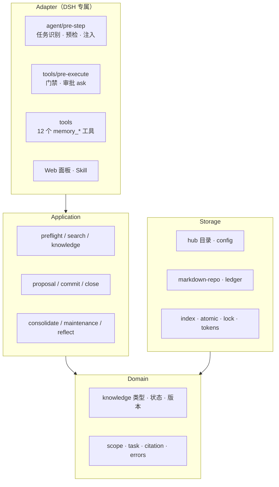
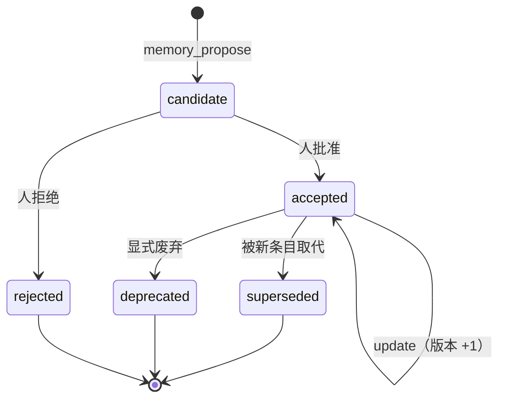
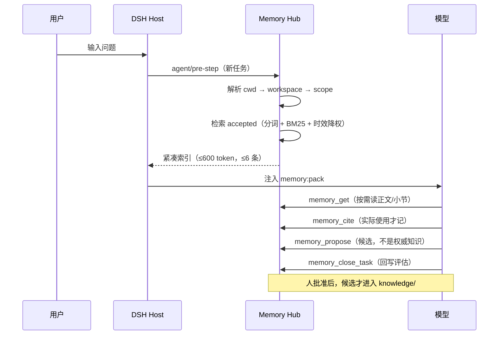

# 把 AI 的记忆当代码来管：一个文件原生、人审写入的记忆中枢

> 副标题：dsh-memory-hub v0.7.0 的设计、工程与演进路线
> 版本：2026-11-11 · 对应 `dsh-memory-hub@0.7.0`

---

## 摘要

大模型不缺"记住这一刻"的能力，缺的是**可信的长期记忆**：写进去的东西凭什么是对的、谁批准的、什么时候过期、出错了怎么删。

`dsh-memory-hub` 是 DeepSeek Harness（DSH）的一个插件，把项目里值得留下的结论存成 Markdown，每个回合做一次确定性检索并注入紧凑索引，写入必须经过人工批准。它不追求"更聪明的记忆"，而是追求**可被信任的记忆**：文件即真相、模型不能自批、零强制依赖。

三个数字概括它的现状：**141 个测试 / 19 个文件**；**10 万条知识、单次检索 p50 399ms、索引磁盘 246MB**；**12 个模型工具**，覆盖检索、引用、提案、审批、时效、去重、回顾与维护。

---

## 一、问题：AI 记忆的四种失败模式

行业里关于"记忆"的讨论，大多从检索开始——向量库、embedding、重排。但真实使用中先出问题的往往是另外四件事。

**1. 没有记忆。** 每个会话从零开始，同一个约束被反复解释，同一个坑被反复踩。上下文窗口再大也不解决：窗口是工作记忆，不是长期记忆。

**2. 假记忆。** 模型声称"你上次说过"，但其实没有；或者把三周前的临时决定当成现行规则。更隐蔽的是**旧偏好劫持**：HorizonBench（arXiv:2604.17283）发现系统经常选中已经被用户改掉的旧偏好。

**3. 黑箱记忆。** 记忆存在哪、长什么样、谁写的、怎么删，全在某个不透明的服务里。想审计、想迁移、想 diff、想用 git 管起来，都做不到。

**4. 记忆反噬。** 记忆越多反而越差。Anthropic 公布的案例里，一个模型写了 413 个记忆文件、225 个目录，最终只拿到 1 个徽章；另一个只写了 9 个文件，拿到 4 个。MemoryAgentBench（arXiv:2507.05257）则显示，上下文从 6K 涨到 32K，GPT-4o 的分数反而从 28% 掉到 10%。

这四种失败模式指向同一个结论：

> **记忆系统的难点在写入治理，不在检索。**

检索决定"能不能找到"，写入治理决定"找到的东西能不能信"。前者是工程优化，后者是产品与制度设计。2026 年的行业共识也在这里收敛：OpenAI 的 dreaming、Anthropic 的离线巩固、OpenClaw 的 provenance、阿里记忆库的抽取规则与审计快照，投的都是写侧。

---

## 二、设计立场：五条不可协商的规则

`dsh-memory-hub` 的所有设计都可以从五条规则推导出来。它们不是"最佳实践"，而是硬约束——违反其中任何一条，宁可不要这个功能。

### 规则一：文件即真相

知识是 `<hub>/knowledge/<type>/<ID>.md`，一条知识一个文件，YAML frontmatter + Markdown 正文。候选在 `pending/`，审计在 `records/ledger.jsonl`（只追加），历史版本在 `history/`。

索引、报告、缓存、水位全部是**派生物**：`records/index.sqlite` 可以随时删掉重建，`reports/` 可以整个删除，`reflect-state.json` 删了只会让回顾重复一次。没有任何能力依赖"某个不透明的二进制里存了真相"。

直接收益：可读、可 diff、可 git、可复制、可迁移、可离线。这条规则也决定了后面所有取舍——比如为什么不要向量库当必需品，为什么 SQLite 只能是索引。

### 规则二：人批准写入，模型不能自批

模型只能 `memory_propose` 写候选；候选变成权威知识，必须经过 DSH 原生审批（会话内 `memory_commit`）或面板里人工点击"批准"（账本记 `panel:human`）。代码层面不存在任何"模型伪造批准"的通道：`memory_commit` 在工具执行前被拦截为 `ask`，审批令牌不在模型参数里。

这条规则会带来一个真实的代价：**吞吐受限于人**。所以本文后面专门讨论"怎么让人看得更快"，而不是"怎么让模型自己写进去"。

### 规则三：零强制依赖

不要求向量数据库、不要求外部服务、不要求联网。检索是本地 CJK 分词 + 倒排索引 + BM25-lite；唯一的数据库是 Node 自带的 `node:sqlite`，而且只在知识条目超过 3 万条时作为**派生索引**启用，不可用时自动回退内存索引。

对一个"要长期运行在用户机器上"的记忆系统来说，依赖不是技术选择，而是**寿命问题**：任何必须联网或必须部署的服务，都会在某一天让用户的记忆变成只读废墟。

### 规则四：一切都能降级

没有 `node:sqlite` → 回退内存索引并记录诊断；宿主没有 `sessionQuery` → 回顾退化为空 digest 而不是报错；写锁被别的进程占用 → 该 Hub 降级为只读，而不是整个进程崩掉；配置文件损坏 → 只让配置 Hub 只读，其他核心 Hub 继续工作。

记忆是"锦上添花"的能力，它**没有资格阻塞一次对话**。

### 规则五：模型不能扩大自己的可见范围

作用域由配置和当前工作目录决定，模型只能用参数缩小范围，不能用参数扩大范围。跨作用域读取要经过可见性校验，越权直接拒绝。

这五条规则合起来，定义了这个系统真正的产品形态：**它不是"AI 的笔记本"，而是"团队的知识账本"，AI 只是账本的记录员和查询员。**

---

## 三、系统全景

### 3.1 分层架构



依赖方向严格单向：`adapter → application → domain`，`storage → domain`。业务层不 import DSH——换一个宿主，只需要重写 Adapter。这是"插件"能活得久的前提。

### 3.2 一个核心仓一个 Hub，Hub 内分层

```text
core_workspaces: [{ id: product, root: E:/work/product }]
workspaces:      [{ id: backend, core_id: product, root: E:/work/product/backend }]
```

- 每个 `core_workspaces[].root` 是**一个独立的 Hub**（独立目录、独立写锁、独立索引）。
- 子工作区的知识写进**所属核心**的 Hub，不单独建库；会话按"工作目录最长前缀"路由。
- 多个核心可以沿 `workspaces[].core_id` 组成**金字塔**：子工作区 → 核心 → 父核心 → …（最多 8 层，带环检测）。
- 默认的 `~/.dsh/memory-hub` 只是**配置 Hub + 兜底 Hub**：它保存 `config.yaml`，并接收"不匹配任何工作区"的会话；它不会收集所有数据。

这个结构解决的是规模化问题：一个库 5k–20k 条是舒适区，按业务域分库比任何索引引擎优化都有效；跨域共性通过向上蒸馏获得，而不是塞进一个巨型库。

### 3.3 每个 Hub 自带一份说明书

V0.7 加了一个看起来很小、实际很关键的能力：`Hub.open` 在可写 Hub 根目录自动生成 `README.md`，写清每个目录"谁写、能不能手改、删了会怎样"，并解释九类知识（尤其是容易被误解的 `assets`）。

规则很克制：同版本不覆盖、用户自己写的 README 绝不覆盖（改写到 `MEMORY-HUB.md`）、只读 Hub 不写。**说明书跟着数据走**，而不是躺在某个 wiki 里等人去找——这对 AI 和人都是同一个入口。

---

## 四、数据模型：一条知识长什么样

### 4.1 文件格式

```markdown
---
id: DEC-000042
type: decision
scope:
  level: project
  workspaceId: backend
status: accepted
version: 3
title: 检索不用向量库，用 CJK 分词 + BM25-lite
summary: 保持零依赖与可解释性，规模靠分库与派生索引解决。
created_at: 2026-08-14T09:12:00.000Z
updated_at: 2026-11-08T10:00:00.000Z
valid_from: 2026-08-14T00:00:00.000Z
expires_at: null
last_verified: 2026-11-08T10:00:00.000Z
source_refs:
  - file:docs/04-development/search-performance.md#L64
tags: [retrieval, design]
supersedes: [DEC-000011]
format: 1
---

## 结论
……

## 证据
……

## 边界
……
```

字段设计里有几个刻意的选择：

- **`version` + `history/`**：每次接受变更都保留旧版本快照，`history/decision/DEC-000042@v2.md`。
- **`supersedes` / `superseded_by`**：被取代不是删除，而是显式关系；检索默认只返回 `accepted`。
- **`valid_from` / `expires_at` / `last_verified`**：时效是一等公民。派生状态 `fresh / aging / stale / scheduled`，不是写死在文件里的标签，而是按"现在"实时计算。
- **`format: 1`**：格式版本闸门。老文件默认 1；遇到比程序更新的格式，拒绝解析并说明原因，而不是猜着读。
- **未知字段保留**（`.passthrough()`）：老版本程序读新文件不会丢数据。

### 4.2 九类知识

| 类型 | 前缀 | 用途 | 证据要求 |
| --- | --- | --- | --- |
| `decision` | DEC | 已做出的选择与理由 | 必须 |
| `constraint` | CON | 不可违反的边界 | 必须 |
| `knowledge` | KNO | 已确认的事实/机制 | 视内容 |
| `api-catalog` | API | 接口、命令、协议清单 | 必须 |
| `process` | PRC | 可复现的流程/步骤 | 必须 |
| `open-questions` | OQ | 未决问题与待验证假设 | 否 |
| `runtime-base` | RUN | 环境、版本、部署前提 | 必须 |
| `playbooks` | PLAY | 排障/操作手册 | 必须 |
| `assets` | AST | **外部资源索引** | 否 |

`assets` 是误解重灾区。它**不是代码资产、构建产物或依赖包**，而是"设计稿、截图、录屏、模板、提示词在哪里、怎么用"。大文件留在原处（网盘、仓库、共享盘），Hub 里只记位置与适用边界。

### 4.3 状态机



`open-questions` 有一条特殊规则：**永远不能自动变成 `accepted`**，只能被新的证据替换或关闭——未决问题不该假装有答案。

### 4.4 目录布局

```text
<hub>/
  README.md              # 自动生成的目录说明书
  config.yaml            # 工作区、策略、时效
  knowledge/<type>/      # 权威知识，只能经审批写入
  pending/               # 候选；archive/ 是已处理
  history/               # 每次提交的旧版本
  records/
    ledger.jsonl         # 只追加的审计账本
    sequences.json       # ID 序列
    index.sqlite         # 派生索引（≥30k 才建，可删）
    reflect-state.json   # 回顾水位
    maintenance-state.json
    .writer.lock         # 每个根一把写锁
  reports/               # 维护报告
```

---

## 五、记忆闭环：一次回合里发生了什么



### 5.1 预检：每回合一次，幂等

- 幂等键 `(sessionId, turn)`：同一回合重复触发不会重复检索、不会重复记账。
- 注入的是**索引**，不是正文：ID、标题、一句话摘要、作用域，预算 600 token、最多 6 条。
- 相关性门控 `min_score` 过滤弱命中；`local_boost` 让当前工作区的知识优先于核心共享知识。
- 预检只覆盖 `accepted`，且排除"尚未生效"（`scheduled`）的条目。

### 5.2 读取：按需，分级

`memory_get` 默认只返回结论摘要 + 小节目录（700 字符封顶）；指定 `section` 读一节（2000 字符封顶）；只有确实需要才 `full: true`。这个设计直接对应一个观察：**把整篇正文灌进上下文，是记忆系统最常见的浪费**。

### 5.3 引用：命中 ≠ 使用

检索命中会出现在注入包里，但"命中"只说明可能相关。真正被采用的条目必须 `memory_cite`，账本记录 ID、版本、用途。这个区分让"记忆有没有用"第一次变得可度量：命中但从不被引用的条目，是检索质量或知识质量问题，而不是"用不上"。

### 5.4 写入：提案与审批分离

```text
模型 memory_propose → pending/PRO-xxxx.md（candidate）
        ↓ 人在 DSH 审批 / 面板点"批准"
memory_commit       → knowledge/<type>/<ID>.md（accepted）
        ↓ 同时
history/ 快照 + ledger 追加事件 + 序号 +1
```

- 精确重复会被 `propose` 拒绝，避免同一结论反复进候选。
- 更新用 `update` + `expected_version`，版本 +1，旧版本进 `history/`。
- 合并用 `merge` + `merged_ids`：保留一条，其余变 `superseded` 并写 `superseded_by`。
- 写入前会做**风险扫描**：注入短语、凭据形态、零宽/方向控制符、角色伪造。风险只标记、不阻断、不改写——它是给人看的信号，不是自动裁判。

### 5.5 收尾：每个任务都要有评估

`memory_close_task` 必须给出四种之一：`proposed`（本轮产出候选）、`no_new_knowledge`（无新知识）、`needs_evidence`（有价值但缺证据）、`deferred`（确实无法评估）。没评估的回合由 Host 自动记 `deferred`。

这看起来是流程洁癖，实际是**数据质量的前提**：没有"这轮学到了什么"的记录，就无法区分"模型没回写"和"这轮确实没有值得写的东西"。

### 5.6 维护：建议者，不是执行者

每天 03:00（可配），Host 内部定时器串行巡检所有 core，写 `reports/<timestamp>.md` 与 `latest.md`，并**可选**生成候选：

- 精确重复 → 生成 `deprecate` 候选；
- 带 `core` / `shared` / `reusable` / `promote` 标签的子工作区知识 → 生成向上晋升候选；
- 近似重复、过期候选、长期未引用、超长正文、作用域异常 → 只写报告。

它**永不** commit、不删除、不改写正文。维护的价值不是"自动整理"，而是把"该整理了"变成一份可执行的清单。

### 5.7 蒸馏与回顾：两个不同的"往上走"

- **蒸馏（distill）**：跨作用域晋升。子工作区 → 核心 → 父核心，按工作区配置定时执行，产出上级候选。
- **回顾（reflect）**：同作用域补漏。读本工作区已结束会话的 digest，找出"当时没记、但以后会再问"的结论；需要核对原始措辞时用 `mode: "search"` 调宿主全文检索，拿到原始事件的 `seq/type/snippet` 作为证据。

两者都只写候选，都需要人批准——这是"自动化"在硬规则下的边界。

---

## 六、设计亮点

### 亮点 1：把写入路径当成安全边界

绝大多数记忆系统的安全设计是"写入后检测"，但记忆投毒研究（AgentPoison：<0.1% 毒化率即可 >80% 攻击成功率）说明这不够。这里的做法是**在写入路径上做准入**：候选 → 人看 → 分配 ID → 进权威区，同时落账本与历史。风险扫描放在人看之前，作为提示而不是判决。

代价是吞吐；收益是**任何一条权威知识都能回答"谁在什么时候、基于什么证据批准的"**。

### 亮点 2：token 经济是一等设计目标

注入 600 token、最多 6 条、摘要 700 字符、按节读取。这不是"省 token"的口号，而是产品约束：如果每轮注入 8k token 的记忆，用户会关掉它。反过来，正因为注入小，才敢每轮都做。

### 亮点 3：检索可解释、可回归

没有 embedding，就没有"相似度 0.83 但不知道为什么"。CJK unigram + bigram 分词、倒排索引、BM25-lite，排序逻辑是一段能读的代码。评测也因此可做：同一查询集，改动前后逐位对比。

### 亮点 4：引用驱动生命周期

维护报告和 aging 会参考**最近一次引用时间**：`uncited` 区分"从未被引用"与"最近引用在 N 天前"。这让"知识新鲜度"有了第二种证据——不只是"多久没改"，还有"多久没人用"。归档仍然只产出 `deprecate` 候选，不自动删。

### 亮点 5：时效是一等公民

`valid_from` / `expires_at` / `last_verified` 三个字段 + 确定性降权 + 预检时效门：未生效的不注入，过期的不消失但降权并标注。这直接对应 HorizonBench 的失败模式：没有"有效期"概念，就一定会用旧偏好回答新问题。

### 亮点 6：金字塔作用域

子工作区看自己的 `project` + 所属核心的 `project` + `global`（只取本 Hub 的 global）。检索"先本层、无命中才上溯"，显式 `scope` 只查指定层。越靠近自己的工作区记忆越完整，越往顶层越是蒸馏过的共性知识——这正是组织记忆应有的形状。

### 亮点 7：派生索引——用磁盘换内存

| 规模 | 内存索引 p50 / 堆 | 派生 SQLite p50 / 磁盘 | 重建 |
| ---: | --- | --- | --- |
| 20k | 39 ms / ~210 MB | 112 ms / 50 MB | 3.0 s |
| 50k | 158 ms / ~600 MB | 231 ms / 124 MB | 8.5 s |
| 100k | 352 ms / ~1.1 GB | 399 ms / 246 MB | 18.7 s |

关键不是延迟（慢了 10–15%），而是**常驻内存从 1.1GB 降到 250MB 磁盘**。派生索引用 contentless FTS5 取候选，再用同一份 JS 精确打分：命中数不超过候选上限时，结果与内存索引逐位一致；超过时是两阶段检索，合成最坏语料 recall@8 = 0.925，候选上限可调。

`storage.index: auto` 的阈值定在 30k：以下内存更快，以上用磁盘换内存。这是"按规模分档"，不是"按偏好选型"。

### 亮点 8：维护只出建议，确定性优先

夜间巡检只做确定性判断：精确重复才出 `deprecate`，近似重复只报告，晋升只认显式复用标签。理由很简单：**自动删除或自动改写是不可逆的**，而"少整理一次"只是慢一点。

### 亮点 9：风险标记不阻断

写入前扫描注入短语、凭据形态、零宽字符、角色伪造，结果进工具响应、账本和面板。它不阻断写入，因为误报会让人放弃使用；它必须显性化，因为漏报会让人放弃信任。

### 亮点 10：格式可演化，老库零迁移

`format: 1` 闸门 + 未知字段透传 + 账本容错（无法解析的行跳过并诊断）+ ID 序列回填（`sequences.json` 丢失时按文件名回填，不撞号）。结果是 V0.1 的 Hub 可以直接被 V0.7 读取，不需要迁移脚本。

### 亮点 11：说明书随 Hub 生成

每个 Hub 根目录的 `README.md` 由程序生成，说明每个目录的职责、能否手改、删除后果、九类知识、写入流程与常见误用。它既是给新人的 onboarding，也是给 AI 的"不要猜"指令——**让 AI 和人读同一份事实**。

---

## 七、工程数据

### 7.1 检索性能与规模上限

| 规模 | 内存 p50 | 内存堆 | 派生索引 p50 | 索引磁盘 |
| ---: | ---: | ---: | ---: | ---: |
| 1k | 0.53 ms | ~24 MB | — | — |
| 5k | 3.94 ms | ~90 MB | — | — |
| 20k | 29 ms | ~190 MB | 112 ms | 50 MB |
| 50k | 107 ms | ~647 MB | 231 ms | 124 MB |
| 100k | 285–352 ms | ~1.1 GB | 399 ms | 246 MB |

（合成语料：确定性 PRNG + Zipf 词频，20 条查询取中位数；Node 24 / Windows。完整方法与复现命令见仓库 `docs/04-development/search-performance.md`。内存版在 2026-11 的两轮基准中，20k 为 29–39 ms、100k 为 285–352 ms；差异来自索引结构微调，趋势一致。）

读法：**5k 以内怎么选都不影响体验；20k 起真正的压力是内存与启动重建，而不是排序质量；100k 必须分库，单库回到 5k–20k 才算舒适。**

### 7.2 候选积压：惰性加载

`pending/` 上千条时，启动只预解析最新 200 条，其余按需加载：3k 候选启动 **3.56s → 0.33s**，10k 候选 0.35s。计数与 ID 序号仍然完整。

### 7.3 工程规模

| 指标 | 数值 |
| --- | --- |
| 源码 | 28 个 TypeScript 文件，约 9.6k 行 |
| 测试 | 141 个（19 个文件），约 4.8k 行 |
| 面板 | `client.js` 约 1.7k 行 |
| 文档 | 67 份 Markdown |
| 模型工具 | 12 个 `memory_*` |
| 单条知识体积 | 约 2.5 KB（Markdown） |

### 7.4 发布

npm Trusted Publisher + GitHub Actions：推送 `v*` tag 后，Windows runner 上跑 typecheck/build/test，打包 tarball，用 OIDC 发布 npm（无 token），生成 SLSA provenance，并创建 GitHub Release。`v0.7.0` 已按此链路发布，npm 记录 `gitHead` 与 provenance。

---

## 八、与同类系统的对照

| 维度 | ChatGPT | Claude（Agent） | Qwen 记忆库 | OpenClaw | Mem0 / Zep | dsh-memory-hub |
| --- | --- | --- | --- | --- | --- | --- |
| 权威存储 | 未公开（注入系统提示） | 文件 + 记忆目录 + wiki | 托管 DB | Markdown + SQLite 索引 | 向量库 / 图数据库 | **Markdown / YAML / JSONL** |
| 谁决定写什么 | 模型 + 后台 dreaming | 自动存 + 模型判断 + dreaming | 用户配规则 + 模型 | 模型 + dreaming，人类可改 | 模型工具调用 ADD/UPDATE/DELETE | **模型提案，人批准** |
| 萃取时机 | 离线为主 | 在线笔记 + 离线 dreaming | 调用时抽取 | 在线 + 压缩前 + 离线 | 每轮（或异步） | 收尾 + 夜间 + 定时蒸馏/回顾 |
| 检索 | 未公开，按需 | 聊天搜索 + wiki 导航 | 语义 + 重排 | BM25 + 向量 + MMR | 向量 / 混合 + 图遍历 | **CJK 分词 + BM25-lite + 金字塔回退** |
| 时效 | V3 自动改写时态 | dreaming 纠错 | 7/30/180 天过期 | 重要性 + 新鲜度 + supersede | 双时间（Zep） | **有效区间 + 派生降权 + supersede** |
| 审计 | 摘要页 + 来源卡 | 组织级日志（个人编辑无） | 审计快照 | provenance + forget | 视实现 | **账本 + history/ + 面板审批** |
| 依赖 | 云服务 | 云服务 | 云服务 | 本地 SQLite | 向量库/图库 | **零强制依赖** |

这张表里最有信息量的一行是"谁决定写什么"：主流系统都在往**更自动的写入**走，而这条路线的正确性依赖"抽取质量足够高 + 用户能纠正"。我们选的是另一条：**写入慢一点，但每一条都可追溯、可撤销、可审计**。

这不是"更先进"，而是不同的目标函数。对于个人笔记，自动写入显然更顺手；对于团队决策与合规场景，"这条结论是谁批准的"比"写入有多快"重要得多。

我们的短板也很清楚：**写侧自动化程度低、缺少效果评测、语义检索弱**。这三点在最后一节展开。

---

## 九、潜力：它适合被用在什么地方

### 9.1 个人与小团队的"git 化记忆"

整个 Hub 可以 `git init`，知识变更就是 commit。diff 能看出"上周谁把部署流程改了"，revert 能撤销一次错误的知识提交，GitHub 能 code review 一条决策。这是黑箱记忆服务给不了的能力。

### 9.2 组织级金字塔：部门记忆 → 公司记忆

每个业务线一个核心 Hub，公司级一个父核心。日常检索在本域完成（5k–20k 的舒适区），共性靠蒸馏上推。这种结构天然对应组织结构，也天然解决"一个巨型库检索越来越差"的问题。

### 9.3 Agent 记忆的可审计基座

对需要审计的行业（金融、医疗、法务），"记忆里写了什么、依据是什么、谁批的"必须能回答。文件 + 账本 + 历史快照是成本最低的可审计方案。

### 9.4 记忆系统的评测夹具

因为它把"写入、检索、引用、时效、维护"拆成了可观测的独立环节，很适合作为评测对象：候选批准率、引用率、过期误用率、近重复对数，都能直接从账本算出来。业界缺的正是这种"可复现的记忆评测"。

### 9.5 离线与内网

零联网依赖意味着可以在完全隔离的内网运行；没有向量库意味着不需要 GPU 或外部 embedding 服务。

---

## 十、局限与风险（诚实清单）

1. **人审是吞吐瓶颈。** 5k 条候选 = 100 次批量审批（单次 ≤50），每次还要看。当前缓解手段是批次过滤、风险标记、近重复预筛，但没有根本解决。
2. **写侧自动化太薄。** 现在只有"模型主动提案 + 夜间确定性扫描 + 定时蒸馏/回顾"。模型不主动回写时，记忆就长不出来——账本里大量任务以 `deferred` 关闭，这是真实数据。
3. **没有效果评测。** 141 个测试保证行为正确，但没有一条指标回答"记忆有没有让回答更好"。这是最大的战略性缺口。
4. **语义检索弱。** 纯词法对同义表达不友好；中文分词能缓解，但"部署"与"发布"这种词仍然靠人写清楚。
5. **`min_score` 绝对阈值会漂移**：语料增长方式不同，分数分布会变，需要在真实 Hub 上持续观察引用率。
6. **多进程/跨机写**：同一 Hub 第二个写者会降级为只读（设计如此）；跨机锁回收仍靠测试覆盖。
7. **面板的人工点击路径**尚未在真实桌面环境完成一次完整人工验收。
8. **回顾依赖宿主事件形状**：`sessionQuery` 的 JSONL 结构与预期不符时，digest 会退化为空而不是报错——宁可少做事，不崩溃。
9. **报告不自动清理**，长期运行会累积小文件（每份约 1KB）。

---

## 十一、演进路线

原则不变：文件仍是唯一权威、不引入强制数据库、不联网、模型不能自批。所有新增能力要么是派生物，要么仍需人审批。

### v0.8：把"写侧"做厚

- **批量萃取产品化**：`batch.yaml` 批次清单、chunk 规则、批次状态机（`draft → extracted → reviewed → distilled → archived`）已经写进 skill 与模板，下一步是面板按批次分组、重复预筛、分级审批（低风险 50 条一批，`decision`/`constraint` 逐条看）。
- **合并建议自动化**：`memory_duplicates` 目前是只读检查，下一步把"高置信近重复"直接做成合并候选，人只看 diff。
- **回顾质量**：用真实会话核对 `sessionQuery` 的事件形状，补上"纠错"路径（对照账本与历史发现说法冲突）。

### v0.9：检索的两级化与评测

- **两级召回**：强命中直接返回，弱命中才起"深挖"（金字塔上溯 + 原文检索）。这是 OpenClaw `escalate` 模式的思路，但保持在本地、无模型调用。
- **MMR 去冗余**：8 个席位里不该出现 3 条同义碎片。
- **自建评测集**：50–100 条真实轨迹，固定 judge 与检索预算，指标包括引用率、过期误用率、候选批准率、近重复对数。

### v1.0：从"个人工具"到"组织记忆"

- **删除语义**：`forget` 的 dry-run 清单、可删/不可删边界、账本留痕。
- **跨 Hub 联邦**：只读快照、按需同步、冲突显式化（而不是自动合并）。
- **可选的语义层**：向量可以加，但必须是**可关闭的增强**，不能成为必需品；关闭后检索质量可度量地下降而不是崩溃。
- **记忆包**：把某个领域的知识导出成可复用的"知识包"，像依赖一样引入——这是文件原生的自然延伸。

---

## 十二、结语

如果只能留一句话：**AI 的记忆不是"存得越多越好"，而是"每一条都说得清来路、经得起追问、删得掉"。**

这个项目选择了最笨的那条路：文件、人工审批、确定性检索、零依赖。它放弃了自动写入的顺滑、语义检索的聪明、云端服务的规模，换来了可读、可审计、可迁移、可离线。

在"AI 越来越会自动记事"的 2026 年，这条路不一定是主流。但对于那些**答案会被拿去执行**的场景，记忆的可信度比记忆的容量更重要。

---

## 附录：复现与延伸

- 仓库：`github.com/zhiwuli0228/dsh-memory-hub`（npm：`dsh-memory-hub`）
- 当前版本：`0.7.0`（2026-11-08 发布，SLSA provenance）
- 复现检索基准：

  ```powershell
  npx vite-node scripts/bench-search.ts --sizes 20000,50000,100000 --candidates 2000
  ```

- 延伸阅读（仓库内）：
  - `docs/01-architecture/design.md` — 分层架构与关键流程
  - `docs/01-architecture/storage-contract.md` — 目录、格式、兼容契约
  - `docs/04-development/search-performance.md` — 检索实测与索引选型
  - `docs/05-domain/memory-landscape-2026.md` — 2026 业界对照与评测基准
  - `docs/05-domain/knowledge-types.md` — 九类知识与证据要求
  - `docs/06-operations/reflection.md`、`docs/06-operations/maintenance.md` — 回顾与维护
